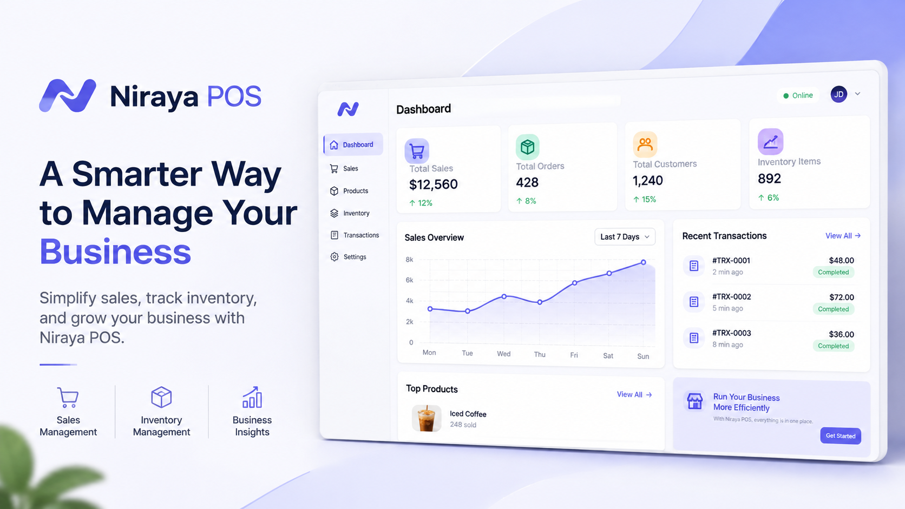

# Niraya POS



Point of Sale (POS) web application built with **Next.js 16**, **React 19**, **TypeScript**, **Tailwind CSS v4**, **shadcn/ui**, **Drizzle ORM**, **Supabase Postgres**, and **Supabase Auth**.

## Stack

- **Framework**: Next.js 16 (App Router), React 19, TypeScript (strict)
- **Runtime**: Bun
- **Styling**: Tailwind CSS v4, shadcn/ui
- **Database**: Drizzle ORM + Supabase Postgres (transaction pooler)
- **Auth**: Supabase Auth (Google OAuth, email/password, magic links)
- **Billing**: Gumroad (subscription webhook)
- **Rate limiting**: Upstash Redis (optional)

## Quick Start

```bash
# Install dependencies
bun install

# Copy environment template
cp .env.example .env

# Fill in .env with your credentials (see below)

# Run development server
bun dev
```

Open http://localhost:3000

## Environment Variables

| Variable | Required | Description |
|---|---|---|
| `NODE_ENV` | Yes | `development` or `production` |
| `NEXT_PUBLIC_APP_URL` | Yes | App URL (e.g. `http://localhost:3000`) |
| `DATABASE_URL` | Yes | Supabase Postgres connection string (pooler port 6543) |
| `NEXT_PUBLIC_SUPABASE_URL` | Yes | Supabase project URL |
| `NEXT_PUBLIC_SUPABASE_PUBLISHABLE_KEY` | Yes | Supabase anon/public key |
| `SUPABASE_URL` | Yes | Supabase project URL (server) |
| `SUPABASE_SECRET_KEY` | Yes | Supabase service role key |
| `SUPABASE_JWKS_URL` | Yes | Supabase JWKS endpoint |
| `GUMROAD_SELLER_ID` | No | Gumroad seller ID |
| `GUMROAD_ACCESS_TOKEN` | No | Gumroad API access token |
| `GUMROAD_PRODUCT_STARTER` | No | Gumroad product ID (Starter plan) |
| `GUMROAD_PRODUCT_PLUS` | No | Gumroad product ID (Plus plan) |
| `GUMROAD_PRODUCT_PRO` | No | Gumroad product ID (Pro plan) |
| `GUMROAD_VERIFY_WEBHOOK` | No | Verify webhook signatures (`true`/`false`) |
| `UPSTASH_REDIS_REST_URL` | No | Upstash Redis REST URL (rate limiting) |
| `UPSTASH_REDIS_REST_TOKEN` | No | Upstash Redis REST token |

## Scripts

```bash
bun dev          # Development server
bun build        # Production build
bun start        # Start production server
bun lint         # oxlint
bun run typecheck # TypeScript check
bun test         # Run tests

bun db:generate  # Generate Drizzle migrations
bun db:migrate   # Run migrations
bun db:push      # Push schema (dev only)
bun db:seed      # Seed business data
bun db:studio    # Drizzle Studio
```

## Features

- **POS Checkout**: Transaction-safe with advisory locks, server-side pricing/tax/stock validation, idempotency
- **QR Ordering**: Table/QR code ordering with guest checkout
- **Inventory**: Stock management, reservations, adjustments
- **Multi-tenant**: Businesses, stores, staff roles (owner, admin, manager, cashier, user)
- **Onboarding**: 6-step wizard for new businesses
- **Billing**: Gumroad subscription sync via webhook
- **Auth**: Supabase Auth with Google OAuth, email verification, password reset

## Project Structure

```
src/
├── app/              # App Router pages & API routes
├── components/       # Shared UI components
├── features/         # Feature modules (POS, inventory, staff, etc.)
├── server/           # Auth, DB, services, repositories
├── lib/              # Utilities, Supabase clients
└── hooks/            # React hooks
```

## Database Schema

13 domain schemas in `drizzle/schema/` (concatenated in `drizzle/init.sql`):

- `core` — Roles, businesses, stores, user profiles, business members
- `products` — Categories, products, variants
- `inventory` — Stock levels, movements, reservations
- `customers` — Customer profiles
- `staff` — Operational staff
- `suppliers` — Supplier management
- `purchases` — Purchase orders
- `transactions` — Sales transactions
- `payments` — Payment records, proofs
- `lookups` — Reference data (business categories, etc.)
- `settings` — Business settings (9 tables)
- `audit` — Audit logs
- `platform` — SaaS plans, subscriptions, webhook events

User profiles (`core.UserProfiles`) use UUID primary key matching `auth.users.id` with FK and RLS policies.

## Deploy

### Vercel (Personal Account)

1. Push to GitHub (personal account repo)
2. Import in Vercel
3. Add all environment variables
4. Deploy

### Supabase Setup

1. Create project at supabase.com
2. Enable Google OAuth in Authentication → Providers
3. Add redirect URLs: `https://your-domain.com/auth/callback`, `https://your-domain.com/verify`
4. Configure email templates (confirm signup, reset password)
5. Run `drizzle/init.sql` in SQL Editor (or `bun db:push`)

### Gumroad Webhook

Add webhook endpoint: `https://your-domain.com/api/webhooks/gumroad`

Events: `subscription_created`, `subscription_cancelled`, `subscription_updated`, `sale_completed`

## License

MIT